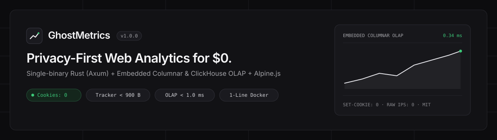

<p align="center">
  
</p>

# GhostMetrics

Cookie-free web analytics compiled into a single **2.44 MB Rust binary** (Axum 0.8 + embedded Alpine.js 3 dashboard + `826 B` tracker script).

- **Storage:** Daily partitioned local columnar store (`.chcol`) out of the box, with an optional native ClickHouse `MergeTree` + `JSONEachRow` HTTP bridge if you outgrow one machine.
- **Privacy:** Zero cookies, zero `localStorage`, zero raw IP persistence—unique visitors are counted with a 256-bit salt kept strictly in RAM and rotated every midnight UTC.
- **Footprint:** Starts in milliseconds on a `$4` VPS without needing Postgres, Redis, or Node.

<p align="center">
  
</p>

## Why another analytics tool?

Most teams end up stuck between three awkward options: shipping Google Analytics' `95 KB+` script and a GDPR cookie banner, paying escalating per-pageview SaaS tiers every time a post takes off, or babying a multi-container self-hosted stack just to check top pages and referrers.

GhostMetrics aims for the middle ground: drop one binary onto a server, add one `<script defer>` tag, and get fast rollups, conversion funnels, and clean ClickHouse SQL exports whenever you want them.

## Comparison

| Capability | GhostMetrics | Plausible Cloud | Fathom | Google Analytics 4 | Umami Cloud |
|---|---|---|---|---|---|
| **Monthly Cost (100k–1M views)** | **$0 forever** | $19–$69/mo | $25–$85/mo | "Free" (ad surveillance) | $20–$100/mo |
| **Deployment Footprint** | **1 Rust binary / 1 Docker line** | Cloud SaaS | Cloud SaaS | Cloud SaaS | Cloud SaaS |
| **Tracker Script Size (raw)** | **826 B** | ~1.4 KB | ~2.1 KB | ~95 KB+ | ~2.3 KB |
| **HTTP Cookies / localStorage** | **0 (Verified in UI)** | 0 | 0 | Multiple | 0 |
| **Raw Visitor IPs Persisted** | **0 (Daily 256-bit RAM salt)** | 0 | 0 | Logged / proxied | Optional |
| **GDPR Cookie Banner Needed** | **No** | No | No | Yes | No |
| **Sub-ms Embedded Columnar OLAP** | **Yes + ClickHouse Bridge** | ClickHouse | Proprietary | BigQuery (paid) | Postgres / CH |
| **Real-Time SSE Live Stream** | **Built-in (`/api/realtime`)** | Polling | Polling | Delayed | Polling |
| **Data Ownership & SQL Export** | **100% (`MergeTree` SQL + CSV + MD)** | CSV only | CSV only | Locked / Paid | CSV |
| **Unlimited Sites & Funnels** | **Yes (JSON plugins)** | Plan-limited | Plan-limited | Complex setup | Plan-limited |

---

## 1-Click Install & Usage

### Option 1: Single Prebuilt Binary (Fastest — Zero Dependencies)

Download the single executable from [GitHub Releases](https://github.com/xity4uu-a11y/ghostmetrics/releases/latest) and run:

```bash
./ghostmetrics serve --addr 127.0.0.1:8080 --seed-demo
```

Open `http://127.0.0.1:8080/` to explore 14 days of seeded analytics, sub-millisecond OLAP rollups, live SSE streaming, and the interactive No-Cookie Compliance Audit drawer.

### Option 2: 1-Line Docker Run

```bash
docker run -d --name ghostmetrics -p 8080:8080 -v ghostmetrics_data:/data ghcr.io/xity4uu-a11y/ghostmetrics:latest
```

### Option 3: Full ClickHouse + GhostMetrics Stack (Docker Compose)

Run GhostMetrics paired with ClickHouse pre-initialized with `schema/clickhouse.sql`:

```bash
GHOSTMETRICS_CLICKHOUSE_URL=http://clickhouse:8123 docker compose --profile clickhouse up -d
```

### Option 4: Build From Source (Pure Rust — Zero OpenSSL/C Dependencies)

```bash
git clone https://github.com/xity4uu-a11y/ghostmetrics.git
cd ghostmetrics
cargo build --release
./target/release/ghostmetrics serve --addr 127.0.0.1:8080 --seed-demo
```

### Embed the 826-Byte Zero-Cookie Tracker

Drop one `<script>` tag into `<head>` on any website or SPA:

```html
<script defer data-site="example.com" src="https://analytics.example.com/ghost.js"></script>
```

What `ghost.js` automatically captures (with zero cookies and zero `localStorage`):
- Initial pageviews and Single-Page App route changes (`history.pushState` + `popstate`)
- Referrer domain (`document.referrer`)
- Campaign parameters (`utm_source`, `utm_medium`, `utm_campaign`)
- Transport via `navigator.sendBeacon` with automatic `fetch(..., { keepalive: true })` fallback

Track custom conversion goals anywhere in your frontend:

```js
window.ghostmetrics('signup_completed', { plan: 'pro' });
```

### CLI Reference

```bash
# Start HTTP server + embedded Alpine.js dashboard (default subcommand)
ghostmetrics serve \
  --addr 0.0.0.0:8080 \
  --data-dir ./ghostmetrics-data \
  --plugins-dir ./plugins \
  --clickhouse-url http://127.0.0.1:8123 \
  --respect-dnt=true

# Query sub-millisecond OLAP metrics directly in your terminal
ghostmetrics stats --data-dir ./ghostmetrics-data --site demo.ghostmetrics.local --range 7d
ghostmetrics stats --data-dir ./ghostmetrics-data --site demo.ghostmetrics.local --range 30d --json

# Export complete ClickHouse MergeTree DDL + MaterializedView + JSONEachRow rows
ghostmetrics export-clickhouse --data-dir ./ghostmetrics-data --out ./clickhouse-export.sql

# Strictly validate community plugin manifests
ghostmetrics validate-plugins --dir ./plugins

# Inspect binary version and exact tracker script payload size
ghostmetrics version
```

---

## No-Cookie Privacy Architecture

GhostMetrics enforces privacy structurally at the protocol and storage layers rather than through policy promises:

1. **Zero Cookies & Zero Web Storage:** Every HTTP route is verified in automated tests to emit **0 `Set-Cookie` headers**. Neither `ghost.js` nor the dashboard writes to `document.cookie`, `localStorage`, or `sessionStorage`.
2. **Daily Rotating 256-Bit RAM-Only Salt:** On startup and at every UTC midnight rollover, `SaltManager` generates a 256-bit cryptographically random salt via OS CSPRNG (`getrandom`) kept **strictly in volatile RAM** and never written to disk. Daily unique visitors are computed as:
   ```text
   visitor_hash = truncate_64bit(SHA-256(daily_ram_salt || 0x1f || site_id || 0x1f || client_ip || 0x1f || user_agent))
   ```
   The raw IP address is discarded immediately after hashing. Yesterday's salt is overwritten in memory, making cross-day tracking mathematically impossible.
3. **Automatic Bot, DNT & Sec-GPC Enforcement:** Requests carrying `DNT: 1` or `Sec-GPC: 1` are honored by default (`--respect-dnt=true`). Known crawlers and headless probes (`Googlebot`, `GPTBot`, `AhrefsBot`, `HeadlessChrome`, `curl`, `python-requests`, uptime monitors) are filtered before storage.
4. **URL & Query PII Redaction:** Sensitive query keys (`email`, `token`, `api_key`, `password`, `secret`, `auth`, `ssn`, `code`, `fbclid`, `gclid`), UUID path segments, email segments, and numeric user/order IDs are stripped or replaced with `[redacted]` before writing to disk.
5. **CSV Formula-Injection Neutralization:** All CSV exports sanitize leading `=`, `+`, `-`, `@`, `\t`, and `\r` characters to prevent spreadsheet formula execution.

---

## Embedded Columnar & ClickHouse Engine

GhostMetrics gives you instant zero-dependency local analytics today and seamless horizontal scale into ClickHouse tomorrow:

- **UTC-Day Partitioned `.chcol` Storage:** Events are appended durably to `<data-dir>/partitions/YYYY-MM-DD.chcol`. On startup, all partitions load into compact **dictionary-encoded in-RAM columnar vectors** (`Vec<i64>` timestamps, `Vec<u64>` visitor hashes, `Vec<u32>` dictionary IDs for paths, referrers, UTMs, browsers, OS, devices, countries, and events).
- **Sub-Millisecond OLAP Rollups:** `GET /api/stats` scans contiguous typed vectors in RAM to compute exact unique visitors, pageviews, bounce rate, views/visit, average session duration, continuous hourly/daily time series, per-page bounce rates, sequential multi-step plugin funnels, and live 5-minute concurrency — reporting real `query_ms` timing on every response.
- **Native ClickHouse `MergeTree` + `JSONEachRow` Bridge:** Set `--clickhouse-url http://127.0.0.1:8123` (or `GHOSTMETRICS_CLICKHOUSE_URL`) to asynchronously mirror batches over a lightweight pure-Tokio HTTP/1.1 `POST /?query=INSERT+INTO+ghostmetrics_events+FORMAT+JSONEachRow` client with automatic non-blocking fallback to the embedded columnar store if ClickHouse is offline.
- **Portable Schema (`schema/clickhouse.sql`):** Includes production `MergeTree` table (`PARTITION BY toYYYYMM(ts) ORDER BY (site_id, toDate(ts), visitor_hash, ts)`), an `AggregatingMergeTree` daily rollup table, and a `MaterializedView`.

---

## Community Plugins

GhostMetrics ships with 5 strictly validated JSON plugins in `plugins/` that execute natively inside the Rust ingestion and OLAP pipeline:

| Plugin ID | Kind | Runtime Behavior |
|---|---|---|
| `referrer-spam-shield` | `referrer_filter` | Drops known ghost-referrer spam domains (and subdomains) on ingestion and tracks blocked counts. |
| `pii-url-redactor` | `pii_redactor` | Strips sensitive query keys and redacts UUID, email, and numeric account/order path segments. |
| `saas-conversion-funnel` | `funnel` | Evaluates sequential multi-step conversion rates (`/` -> `/pricing` -> `/signup` -> `signup_completed`) in `/api/stats`. |
| `traffic-spike-webhook` | `spike_alert` | Monitors live 5-minute visitor concurrency and raises dashboard alert banners when thresholds trigger. |
| `weekly-markdown-digest` | `digest_template` | Renders shareable privacy-attested Markdown reports at `GET /api/export/digest.md`. |

Add your own plugin by dropping a validated JSON manifest into `plugins/` — see [CONTRIBUTING.md](CONTRIBUTING.md) for the 25-line template and schema rules.

---

## HTTP API Reference

| Method & Endpoint | Description |
|---|---|
| `GET /` | Self-hosted Alpine.js 3 Light/Dark dashboard (0 cookies, 0 external CDNs). |
| `GET /ghost.js` | Embedded 826-byte zero-cookie tracker script. |
| `POST /api/event` | Beacon ingestion (`application/json` or `text/plain` from `sendBeacon`, returns `202 Accepted`). |
| `GET /api/stats?site=...&range=7d` | Sub-millisecond OLAP metrics, time series, funnels, spike status, and compliance attestation. |
| `GET /api/realtime` | Server-Sent Events (`event: hit`) real-time visitor stream. |
| `GET /api/sites` / `POST /api/sites` | List or register tracked domains (optionally guarded by `--admin-token`). |
| `GET /api/plugins` | List active JSON plugins and live runtime filter/redaction counters. |
| `POST /api/demo/seed` | Seed 14 days of realistic developer-site telemetry for `demo.ghostmetrics.local`. |
| `GET /api/export/clickhouse.sql` | Download full ClickHouse `MergeTree` DDL + `JSONEachRow` dump. |
| `GET /api/export/csv` | Download formula-safe CSV export. |
| `GET /api/export/digest.md` | Download Markdown analytics digest rendered by `digest_template` plugin. |
| `GET /healthz` | Health check and live privacy compliance JSON summary. |

---

## License

MIT License — see [LICENSE](LICENSE) and [THIRD_PARTY_NOTICES.md](THIRD_PARTY_NOTICES.md).
